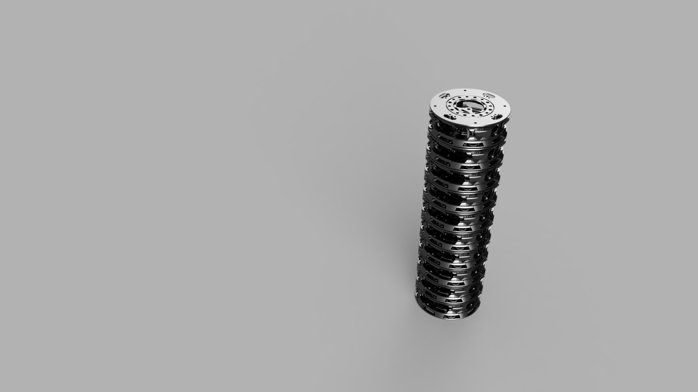

# Coralboard™ stackable hub

A tool-less 3D-printed case and mounting system for the Coralboard hub. A single assembly is 123 mm in diameter and 40 mm tall, including both mount plates. The design supports stacking, VESA 75 mounting, cable tie or Velcro mounting, and several fan options. All parts fit on a 260 × 260 mm print bed without supports.

## Files

- [`CBHv3.3mf`](model/CBHv3.3mf) — default geometry; import as geometry only.
- [`CBHv3 (Project).3mf`](model/CBHv3%20(Project).3mf) — preconfigured slicer project.
- [`CBHv3.f3d`](model/CBHv3.f3d) — editable Fusion 360 source.
- [`CBHv3.step`](model/CBHv3.step) — neutral CAD exchange file.
- [`CBHv3.stl`](model/CBHv3.stl) — mesh file.
- [Engineering drawing](documentation/CBHv3%20chart.pdf)
- [Full build, fit, and printing notes](documentation/Coralboard%20stackable%20hub.md)

PETG was used for the design and print testing. The documentation includes fit notes for other materials and slicer settings tested on a Creality Hi with a 0.4 mm nozzle.

## Media

- [CAD renders](media/renders/)
- [Enhanced photos](media/photos/)
- [Looping GIFs](media/gifs/)

The uploaded photo copies have GPS location metadata removed. The rendered reference images are CAD renders; photos show printed parts and tests.

## License

See [LICENSE](LICENSE) (GPL-3.0).